# Codeyoung Trial-Class Booking

A web app where parents book a **free 1:1 trial class** without creating an account. The system automatically assigns a free mentor and emails **both** the parent and the mentor, each with the class time in their own local time zone.

**Stack:** React + Vite · Node.js + Express · PostgreSQL

---

## Table of contents
1. [Features](#features)
   - [Screenshots / workflow](#screenshots--workflow)
2. [How the booking rules work](#how-the-booking-rules-work)
3. [Project structure](#project-structure)
4. [Run locally](#run-locally)
5. [Configuration (environment variables)](#configuration-environment-variables)
6. [Mentors: names, emails and shifts](#mentors-names-emails-and-shifts)
7. [Sending real emails](#sending-real-emails)
8. [Tests](#tests)
9. [API reference](#api-reference)
10. [Deploying (Render)](#deploying-render)
11. [Troubleshooting](#troubleshooting)

---

## Features

**Home page** – hero section, courses (coding, maths, science, English, robotics), about, newsletter, parent reviews and a doubt box. The nav bar has Home, Courses, About, Contact, Help (Contact and Help are placeholders) and a **Book a Trial Class** button that opens `/book`.

**Booking journey (no login needed)**
1. **Details page** – name, email, phone (with country code) and time zone.
2. **Date & time page** – pick a date on the calendar and a time slot. The page shows how many slots are free that day. If all slots are taken it shows **No Slots Available** with the message *"No slot is available today! You can try to book tomorrow."*
3. **Confirmation page** – booked time, mentor's name and the class link. A cancel option is available here.

**Automatic emails**
- **Parent:** class time in *their* local time, mentor's name, join link and cancel link.
- **Mentor:** the *same* class in the mentor's own local time (India), parent's name and join link.
- Cancelling frees the slot and emails both sides.

**Time zones:** all times are stored in UTC and converted using IANA zones (via `date-fns-tz`), so daylight saving is always correct. Example: a UK parent booking 5:30–6:30 PM BST is shown to the mentor as 10:00–11:00 PM IST. Times that don't exist (spring forward) or occur twice (fall back) are never offered and are rejected by the API.

### Screenshots / workflow

The images below follow the real journey, from the home page to the emails both people receive. All files are in [`docs/screenshots/`](docs/screenshots/).

#### A. Home page

**1. Hero** – headline, "Free trial class · Live 1:1 mentors" badge and the **Book a FREE trial class** button.

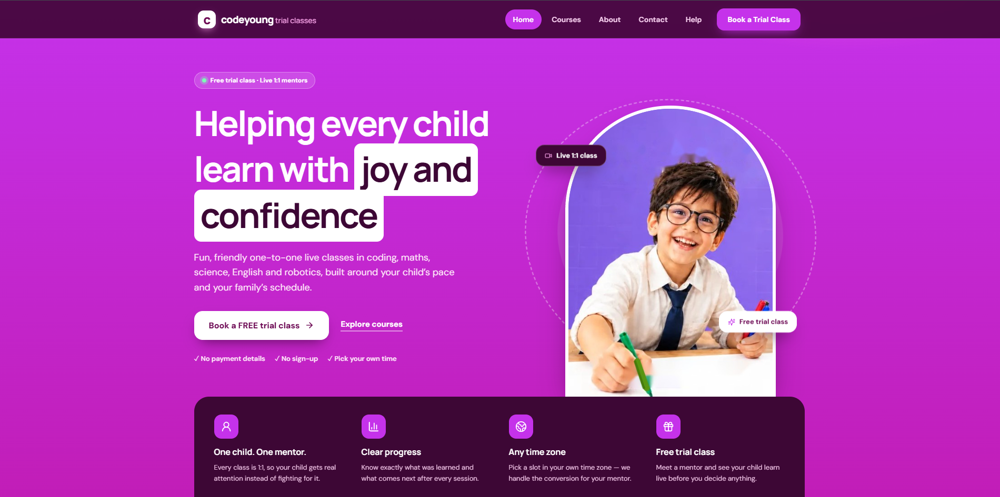

**2. Courses** – coding, maths, science, English and robotics.

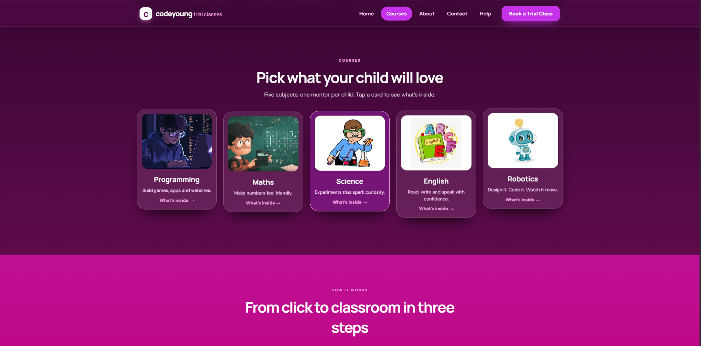

**3. How it works and About** – the three simple steps (share details → pick a date & time → join the class) and the about section.

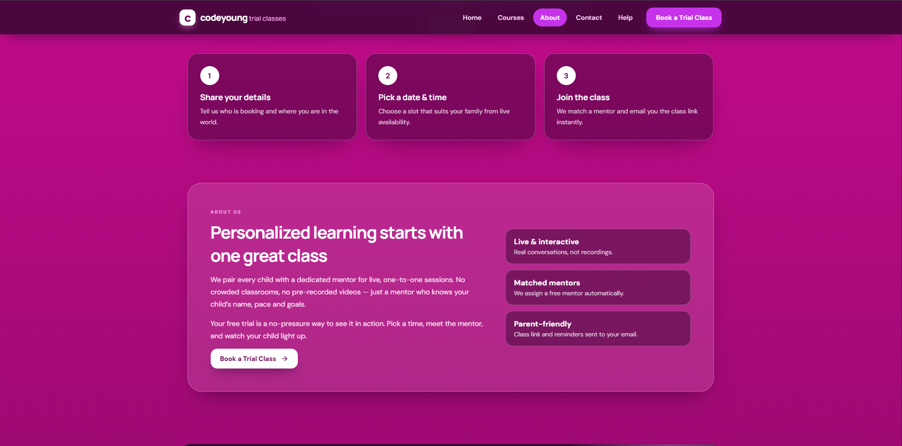

**4. Newsletter and parent reviews**

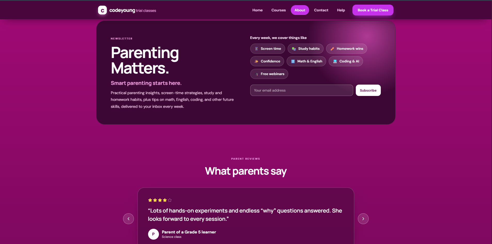

**5. Doubt box and footer**

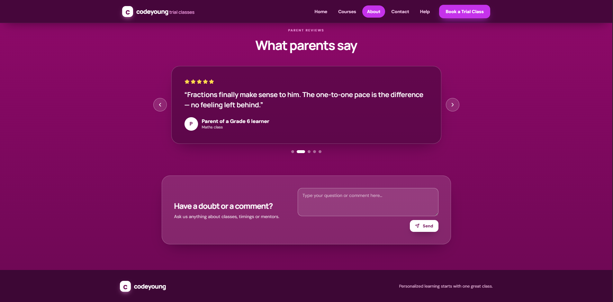

#### B. Booking a trial class (no login)

**6. Step 1 – Your details**: parent's name, email, phone with country code, and time zone.

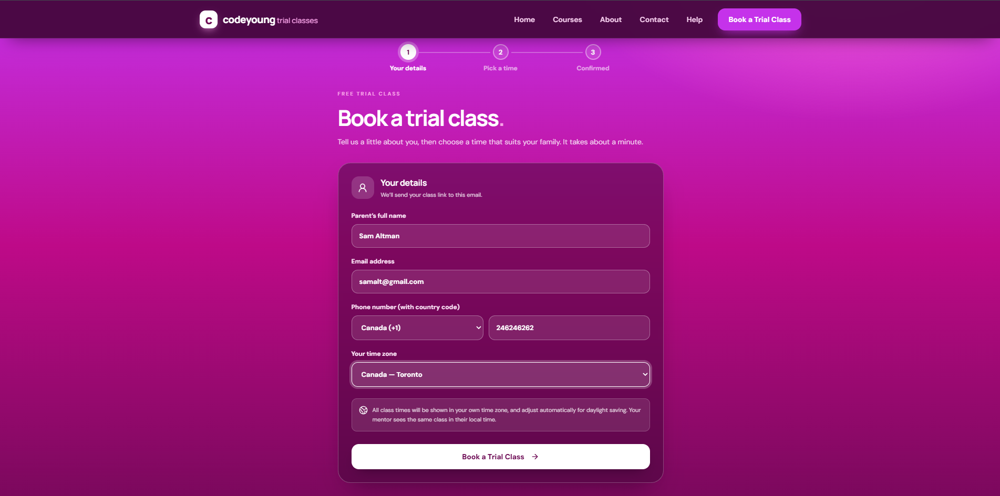

**7. Step 2 – Pick a date & time**: choose a day on the calendar and a slot. Times are shown in the parent's own time zone (here Canada – Toronto, EDT).

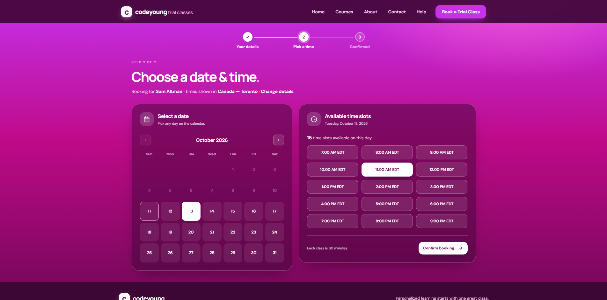

**8. Step 3 – Confirmed**: mentor name, class time, demo class link, booking reference and a **Cancel this booking** option.

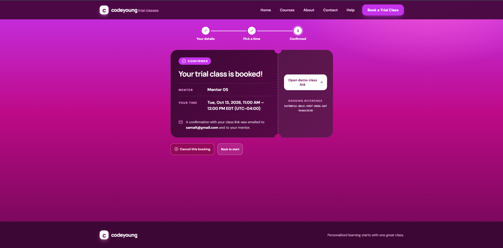

#### C. Emails sent automatically

**9. Parent email** – mentor name, class time in the parent's local time (EDT), join link and cancel link.

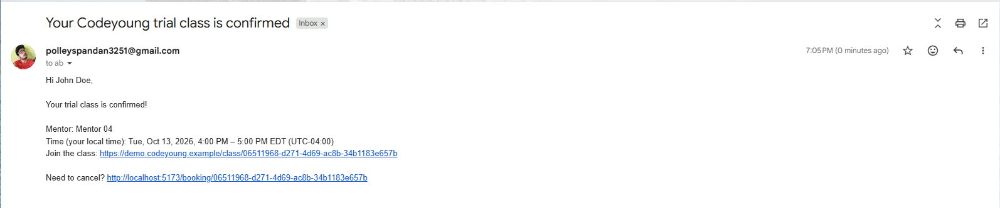

**10. Mentor email** – the same class shown in the mentor's local time (IST), with the parent's name and join link.

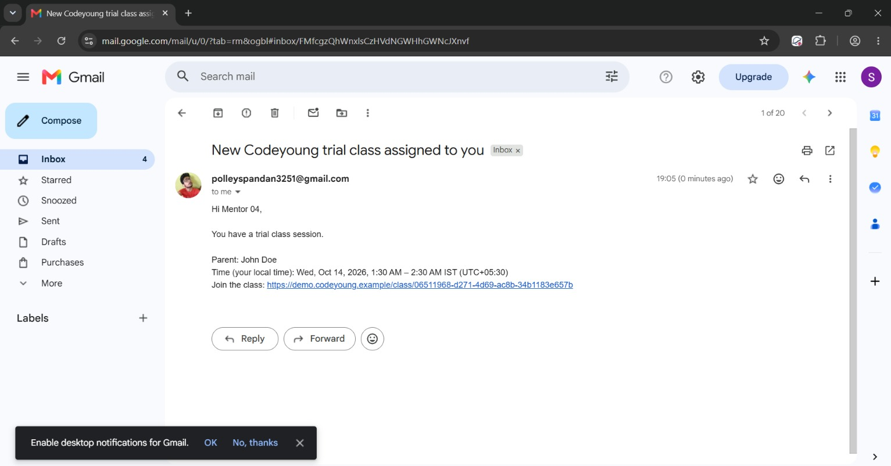

#### D. When the day is full

**11. No Slots Available** – once all 20 daily slots are booked (10 mentors × 2 classes), the parent sees a clear message and can try another date.

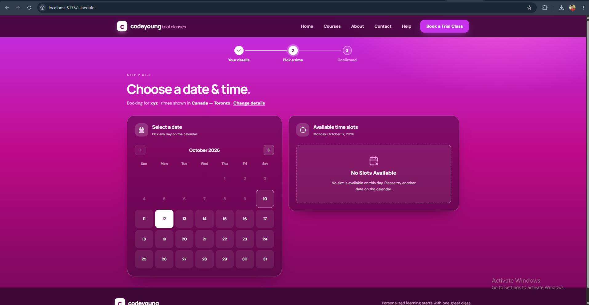

---

## How the booking rules work

| Requirement | Implementation |
|---|---|
| 10 mentors | Seeded in `database/seed.sql` with a name and email each. |
| 20 bookings per day | 10 mentors × 2 classes = 20. Once all are taken the day shows **No Slots Available**. |
| Max 2 classes per mentor per day | Counted on the mentor's **local calendar day AND per shift**, so an overnight shift can never be split into two "days" (which used to allow 4 classes). Runs inside a transaction with a Postgres advisory lock, so simultaneous bookings cannot oversubscribe a mentor (tested with 15 parallel requests). |
| Automatic mentor assignment | The free mentor with the fewest classes that day is chosen. |
| Class links | A unique dummy link per booking, shown on the confirmation page and in both emails. |
| Slot taken a moment earlier | The parent gets a clear message and the slot list refreshes. |

**Other behaviour**
- **One upcoming trial class per email address** (`MAX_ACTIVE_TRIALS_PER_PARENT`, `0` = unlimited), so one family can't hold many of the 20 daily slots.
- Contact details (email/phone) are never returned by the API; booking ids are unguessable UUIDs.
- Booking requests are rate-limited per IP.
- Parents can choose class start times between 07:00 and 21:00 their local time (`BOOKABLE_FROM_HOUR` / `BOOKABLE_TO_HOUR`).

---

## Project structure

```
codeyoung-trial-booking/
├── backend/
│   ├── src/
│   │   ├── server.js                  starts the API, checks the database
│   │   ├── app.js                     Express app, security middleware
│   │   ├── config/env.js              reads environment variables
│   │   ├── db.js                      PostgreSQL connection pool
│   │   ├── routes/booking.routes.js   validation (zod) + response shaping
│   │   ├── services/booking.service.js  transaction, limits, queries
│   │   ├── services/allocation.js     pure rules: working hours, daily/shift cap, mentor choice
│   │   ├── utils/time.js              time-zone / DST maths and formatting
│   │   ├── utils/email.js             SMTP, or console output when SMTP is not set
│   │   └── middleware/, utils/errors.js
│   ├── test/                          unit + API/database tests
│   └── .env.example
├── docs/
│   └── screenshots/                   README images (01 … 11, in workflow order)
├── database/
│   ├── schema.sql                     tables
│   └── seed.sql                       10 mentors
└── frontend/
    ├── src/
    │   ├── pages/                     Home, Details, Schedule, Confirmation
    │   ├── components/                Calendar, Layout
    │   ├── data/home.js, countries.js, timezones.js
    │   ├── home.css, theme.css, styles.css
    │   └── App.test.jsx               full parent-journey tests
    └── .env.example
```

---

## Run locally

**Requirements:** Node.js 20+ and PostgreSQL 14+.

### 1. Database
```bash
createdb codeyoung_booking
psql -d codeyoung_booking -f database/schema.sql -f database/seed.sql
```
(On Windows, use pgAdmin or `psql -U postgres` if `createdb` isn't on your PATH.)

### 2. Backend API → http://localhost:8090
```bash
cd backend
cp .env.example .env      # then edit DATABASE_URL (user/password) for your PostgreSQL
npm install
npm run dev
```

### 3. Frontend → http://localhost:5173
Open a second terminal:
```bash
cd frontend
cp .env.example .env
npm install
npm run dev
```

Open **http://localhost:5173** and book a class. Until SMTP is configured, both emails are printed in the **API terminal** (look for `SIMULATED EMAIL`).

> Upgrading from an older version? Re-run the `psql … -f database/schema.sql -f database/seed.sql` command. It detects old tables and rebuilds them (old test bookings are discarded).

---

## Configuration (environment variables)

### Backend (`backend/.env`)

| Variable | Default | Purpose |
|---|---|---|
| `PORT` | `8090` | API port |
| `DATABASE_URL` | – | PostgreSQL connection string |
| `TEST_DATABASE_URL` | – | Separate empty database used only by `npm test` |
| `FRONTEND_ORIGIN` | `http://localhost:5173` | Frontend URL allowed by CORS and used in email links |
| `CLASS_DURATION_MINUTES` | `60` | Length of each class |
| `MEETING_BASE_URL` | demo URL | Base of the dummy class link |
| `MAX_ACTIVE_TRIALS_PER_PARENT` | `1` | Upcoming trials per email (`0` = unlimited) |
| `BOOKABLE_FROM_HOUR` / `BOOKABLE_TO_HOUR` | `7` / `21` | Parent-local hours classes can start |
| `BOOKING_RATE_LIMIT` | `40` | Booking/cancel requests per IP per 15 minutes |
| `SMTP_HOST`, `SMTP_PORT`, `SMTP_SECURE`, `SMTP_USER`, `SMTP_PASS`, `EMAIL_FROM` | empty | Real email sending (see below) |

### Frontend (`frontend/.env`)

| Variable | Example | Purpose |
|---|---|---|
| `VITE_API_URL` | `http://localhost:8090/api` | Where the frontend finds the API |

---

## Mentors: names, emails and shifts

The 10 mentors live in the `mentors` table (`database/seed.sql`). Their emails are **placeholders** (`mentor01@codeyoung.example`). To send to real inboxes:

```sql
UPDATE mentors SET name = 'Asha Verma', email = 'asha@gmail.com'
WHERE email = 'mentor01@codeyoung.example';
```

All mentors are in India, with staggered shifts (some cross midnight) so US/UK parents get sensible hours. Times are Asia/Kolkata:

| Mentors | Shift | Covers well |
|---|---|---|
| 01–03 | 09:00–21:00 | India, UK mornings |
| 04–06 | 17:00–03:00 | UK afternoon/evening, US mornings |
| 07–10 | 01:00–11:00 | US afternoon/evening |

---

## Sending real emails

If SMTP isn't configured, emails are only printed in the API terminal. To send real ones, set these in `backend/.env` and restart the API. For Gmail you need an **App Password** (Google Account → Security → 2-Step Verification → App passwords), not your normal password:

```
SMTP_HOST=smtp.gmail.com
SMTP_PORT=587
SMTP_SECURE=false
SMTP_USER=your.address@gmail.com
SMTP_PASS=<16-character app password>
EMAIL_FROM=Codeyoung Trial Classes <your.address@gmail.com>
```

All of `SMTP_HOST`, `SMTP_USER`, `SMTP_PASS` and `EMAIL_FROM` must be set, otherwise the app stays in console-only mode.

> **Render free plan:** free web services block outbound SMTP ports 25, 465 and 587, so Gmail SMTP will time out there. Either upgrade the backend to a paid instance, or send email through an HTTPS email API (for example Brevo or Resend) instead of SMTP.

---

## Tests

```bash
cd backend  && npm test    # unit tests always run; API + database tests need TEST_DATABASE_URL
cd frontend && npm test    # parent journey, calendar, validation, "No Slots Available"
```

For the database tests create an empty database (`createdb codeyoung_test`) and set `TEST_DATABASE_URL` in `backend/.env`. These tests rebuild that database's tables, so **never point it at real data**.

---

## API reference

| Method | Path | Description |
|---|---|---|
| GET | `/api/availability?date=YYYY-MM-DD&timezone=Europe/London` | Free start times for that parent-local date |
| POST | `/api/bookings` | Body: `{ name, email, phone: "+44 7700900123", startLocal: "2026-10-12T17:00", parentTimezone }` |
| GET | `/api/bookings/:id` | Booking details |
| POST | `/api/bookings/:id/cancel` | Cancel a booking |
| GET | `/api/health` | Health check |

Errors return `{ message, code }`, for example `NO_MENTOR_AVAILABLE`, `TRIAL_LIMIT_REACHED`, `VALIDATION_ERROR`.

---

## Deploying (Render)

1. **Database:** create a PostgreSQL instance on Render. Run `database/schema.sql` then `database/seed.sql` against it (use the external connection string with `psql`).
2. **Backend (Web Service):**
   - Root directory: `backend`
   - Build command: `npm install`
   - Start command: `npm start`
   - Environment: `DATABASE_URL` (the Render database's internal URL), `FRONTEND_ORIGIN` (your frontend URL), plus any email settings above.
3. **Frontend (Static Site):**
   - Root directory: `frontend`
   - Build command: `npm install && npm run build`
   - Publish directory: `dist`
   - Environment: `VITE_API_URL=https://<your-backend>.onrender.com/api` (set before building)
   - Add a rewrite rule `/*` → `/index.html` so page refreshes on `/book` work.
4. Free instances sleep after inactivity, so the first request may take about a minute.

---

## Troubleshooting

| Problem | Fix |
|---|---|
| "Database is not ready" when starting the API | Run `psql -d codeyoung_booking -f database/schema.sql -f database/seed.sql`, then restart. |
| Every day shows **No Slots Available** | No active mentors; load them with `database/seed.sql`. |
| Frontend can't reach the API / CORS error | Check `VITE_API_URL` in the frontend and `FRONTEND_ORIGIN` in the backend. |
| Emails only appear in the terminal | SMTP variables are missing or incomplete; see [Sending real emails](#sending-real-emails). |
| `Invalid login` / `535` from Gmail | Use a Gmail App Password, not your normal password. |
| `ETIMEDOUT` / connection timeout on Render | Free Render blocks SMTP; upgrade or use an email API. |
| Mentor never receives email | Mentor emails are placeholders; update them in the `mentors` table. |
| Database tests are skipped | Set `TEST_DATABASE_URL` to an empty test database. |
